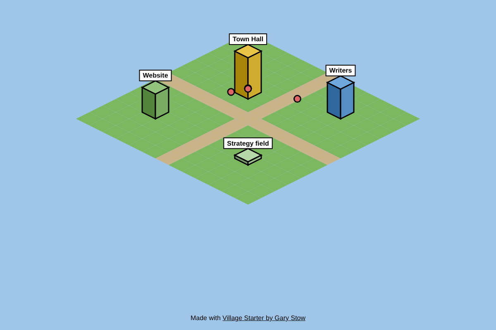

# Village Starter

Watch your AI agents and automations at work as a little isometric village.

Every job your automations do becomes a person walking between buildings. Pages become houses that grow with their visits, and results become fields that grow or wilt. No game engine, no paid tools: Python, Flask and one HTML canvas.

**See the full version running live:** [Gary HQ Village](https://garystow.co.uk/village/)
**Step-by-step guide that explains every line:** [How to Build a Live Village Dashboard for Your AI Agents](https://garystow.co.uk/articles/how-to-build-a-live-village-dashboard-for-your-ai-agents/)

## Run it in 4 steps

1. Install Flask once: `pip install flask`
2. Add some sample events: `python log_activity.py`
3. Start the village: `python server.py`
4. Open http://localhost:5007/village/ in your browser

(On Windows, use `py` instead of `python` if `python` opens the Microsoft Store.)

## Make it yours

- Call `log_activity("writer", "what happened")` from your own scripts.
- Change `BUILDING_FOR` in `village_data.py` to map your job names to buildings.
- Change `BUILDINGS` near the bottom of `village/index.html` to rename, move and recolour buildings.
- Before you put it online, run `python make_public.py` and publish `public/village_data.json`, never the private file.

## Files

| File | What it does |
|---|---|
| `log_activity.py` | Step 1: one line of JSON per event |
| `village_data.py` | Step 3: turns the log into `village/village_data.json` |
| `village/index.html` | Steps 4 to 8: draws the village on a canvas |
| `server.py` | Step 9: the private village on your own computer |
| `make_public.py` | Step 10: a public-safe copy of the data |

## Credit

Built by [Gary Stow](https://garystow.co.uk/). MIT licence: use it however you like. If you share your village, a link back to the guide is appreciated, and I would love to see it.
